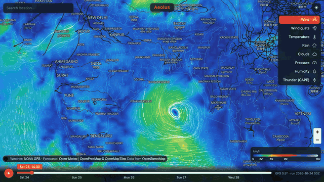
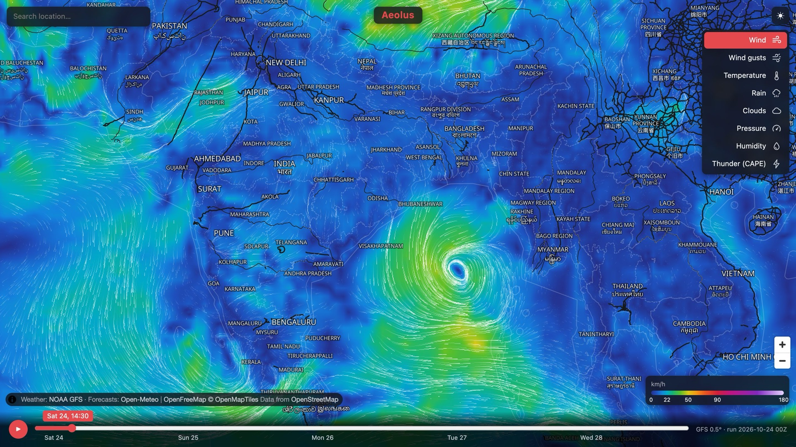
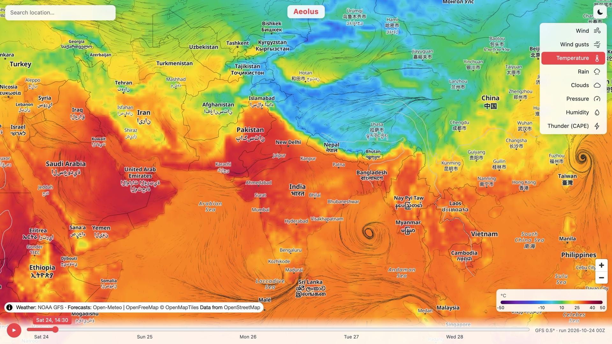
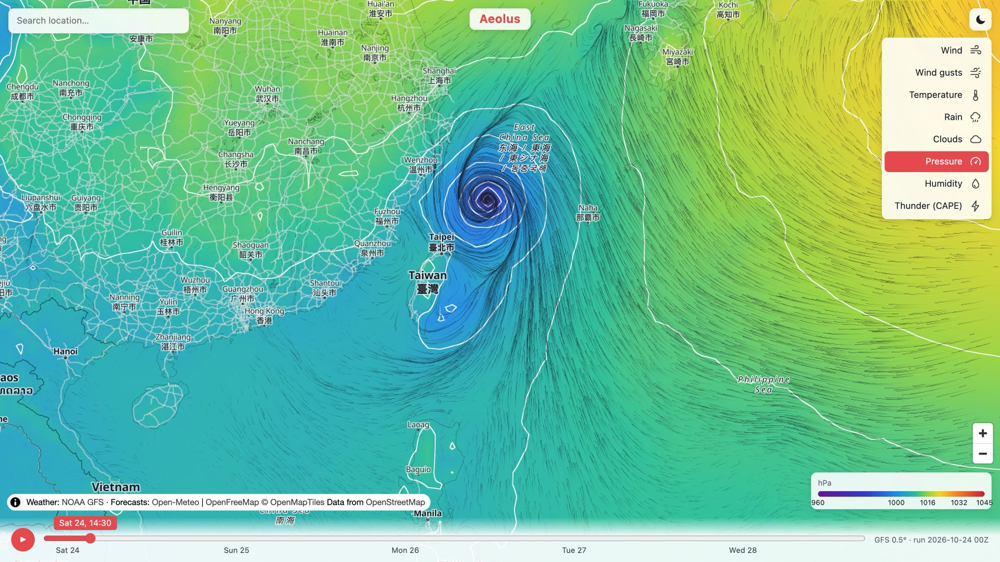
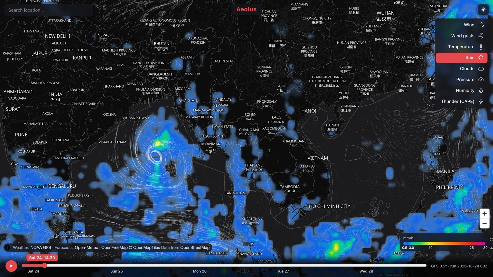
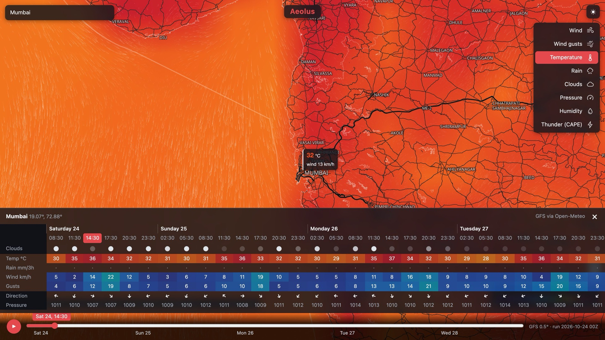

<h1 align="center">Aeolus</h1>

<p align="center">
  An open-source animated weather map in the spirit of windy.com:<br>
  WebGL wind particles, colour overlays, a 5-day timeline and point forecasts, built only on open data.
</p>

<p align="center">
  <a href="https://rajpdus.github.io/aeolus/"></a>
  <a href="https://github.com/rajpdus/aeolus/actions/workflows/deploy.yml"></a>
  <a href="LICENSE"></a>
  
  
  <br>
  
  
  
  
  
</p>

<p align="center">
  <a href="https://rajpdus.github.io/aeolus/"></a>
</p>

## Features

- **Eight layers:** wind (with animated particles), gusts, temperature, rain, clouds, pressure (with isobars), humidity and thunderstorm potential (CAPE)
- **Timeline:** 5 days in 3-hour steps; playback blends smoothly between steps
- **Point forecast:** click anywhere, or search a place, for a 6-day table of temperature, rain, wind, gusts, direction, clouds and pressure
- **Light and dark themes:** the default follows your system; switch with the ☀/☾ button
- **Shareable links:** the map position is kept in the URL (`#map=zoom/lat/lon`), and `?layer=temp&theme=light` pins the layer and theme
- **Units:** click the legend to cycle km/h, m/s, kt and Beaufort, or °C and °F

## Screenshots

<table>
  <tr>
    <td width="50%"><br><sub><b>Wind</b>, dark theme: a cyclone in the Bay of Bengal</sub></td>
    <td width="50%"><br><sub><b>Temperature</b>, light theme</sub></td>
  </tr>
  <tr>
    <td><br><sub><b>Pressure</b> with 4 hPa isobars around a typhoon near Taiwan</sub></td>
    <td><br><sub><b>Rain</b>, dark theme</sub></td>
  </tr>
  <tr>
    <td colspan="2"><br><sub><b>Point forecast</b> for Mumbai: search a place or click the map</sub></td>
  </tr>
</table>

## Data sources

| What | Source | Licence |
|---|---|---|
| Map layers | NOAA GFS 0.5°, from the [NOAA Open Data bucket on AWS](https://registry.opendata.aws/noaa-gfs-bdp-pds/) | US public domain |
| Basemap | [OpenFreeMap](https://openfreemap.org/) (OpenMapTiles) | © OpenStreetMap contributors |
| Point forecasts and search | [Open-Meteo](https://open-meteo.com/) | CC BY 4.0. The free API is non-commercial only; self-host it (AGPL) or buy a plan for commercial use |

## Run

```sh
uv venv .venv && uv pip install --python .venv/bin/python -r ingest/requirements.txt
npm install
npm run ingest   # newest complete GFS run -> public/data (~40 MB, about 3 min)
npm run dev      # http://localhost:5173
```

## Deploy

`.github/workflows/deploy.yml` builds the app, runs the ingest and publishes both to GitHub Pages
on every push to `main` and every 6 hours (about 5.5 h after each GFS cycle). Weather data is
never committed; each deploy fetches it fresh. To host a fork, enable Pages with source "GitHub
Actions" in the repository settings.

GitHub disables scheduled workflows after 60 days without repository activity. If the live data
goes stale, re-enable the workflow or push a commit.

## How it works

```
ingest/gfs.py   .idx byte ranges -> only the needed GRIB2 messages -> eccodes -> PNG textures
public/data/    manifest.json + NNN/{wind,temp,rain,...}.png   (720x361, equirectangular)
src/weatherLayer.ts  MapLibre custom layer (WebGL2)
src/data.ts     texture loading + CPU sampling for the picker
src/forecast.ts point-forecast table (Open-Meteo, GFS model)
```

- **Encoding:** each value is packed into 8 bits between fixed min/max limits listed in the
  manifest (rain and CAPE are sqrt-scaled). Wind keeps u in R and v in G. Pressure is 16-bit
  (R holds the high byte, G the low byte) so the isobars are smooth.
- **Overlay:** a full-screen fragment shader turns each pixel into Web Mercator, then lon/lat,
  then a texture coordinate. It filters manually on decoded values, blends the two neighbouring
  forecast steps, looks up a 256-entry colour ramp, and draws isolines with `fwidth`.
- **Particles:** positions live in an RGBA32F texture in screen space. Each frame they are
  advected by the wind in a ping-pong pass and drawn as line segments into a trail texture that
  fades over time. Particles reset when the map stops moving.

See `docs/RECON.md` for what we learned about how windy.com works, and
`docs/DATA_SOURCES.md` for other open feeds to plug in next.

## Licence

MIT. Weather data and basemap carry their own attribution terms (shown in the map's attribution).
"Windy" is a trademark of Windyty SE; this project is unaffiliated and uses none of its code,
assets or data.
